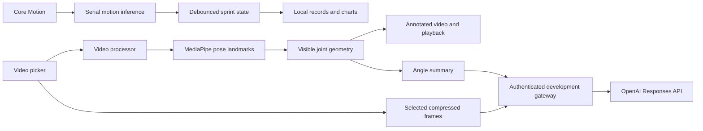

# Architecture

SprintAI uses feature-oriented folders with small services and observable view models. SwiftUI screens own their view models with `StateObject`. View models coordinate main-thread presentation state; sensor inference and video work execute away from the UI.

## Timing

`MotionClassifier` owns Core Motion and inference on one serial operation queue. Device motion supplies a single timestamp for acceleration and rotation. Gravity is added back to user acceleration to preserve the previous gravity-inclusive input convention. Timestamp-based interpolation provides a uniform 50 Hz input grid and resets on delivery gaps over 100 ms. Normalization and thresholds are kept with the model integration.

`SprintStateMachine` is a platform-independent value type. It debounces positives and negatives, rejects nonmonotonic timestamps, and emits start/finish events. Durations use sensor time, backdated to the first decision in each confirmed run so confirmation counts do not shift boundaries. The UI display uses monotonic uptime. There is no delayed reset that can interrupt a subsequent sprint.

A session identifier rejects callbacks from an earlier recording. Leaving timing or backgrounding the app stops monitoring and discards an incomplete sprint. History keeps the existing `sprintTimes` UserDefaults key and Codable schema. A decode failure surfaces an error rather than silently replacing data.

## Video

`VideoProcessor` owns a reader, writer, landmarker, renderer, and local angle list for each job. It bakes the source orientation into upright frames, checks reader/writer failures, honors cancellation, and removes partial output on failure. Only completed exports are returned to the view model. Export is silent; source audio is not copied.

`AnnotationDrawer` calculates confidence-filtered camera-side joint angles and draws the skeleton. Degenerate geometry produces no measurement. `AnalysisViewModel` guards updates by video identity, owns cancellable tasks, and removes app-owned temporary files when a video is cleared.

Playback observations have an owned token removed on deinitialization. Displayed measurements use a binary search for the nearest sample within 100 ms of playback time. Missing detections remain gaps, and seeking does not carry old measurements forward. The player view is identified by its export URL so its observer is recreated for each video.

## Feedback

`FeedbackFrameExtractor` uses evenly spaced frames plus large knee-angle changes. Frames are bounded, JPEG-compressed, and labeled with their actual timestamps. The view model cancels stale requests, and the client calls only the configured backend. The server keeps the provider key in its environment and requests `store: false`.

The included gateway is intended for local development. It deliberately does not implement a production identity service, deployment platform, or persistent data store. The app's manually entered development access token belongs in Keychain. A distributed app should use short-lived per-user credentials from a real authentication service.

## Tests

`Package.swift` exposes the exact files under `SprintAI/Core` as `SprintCore` for fast macOS tests. The Xcode app compiles those same files directly. Hosted iOS tests cover the actual bundled Core ML model, MediaPipe initialization, synthetic video export, cancellation, and annotation orientation without publishing athlete footage or making network requests.
