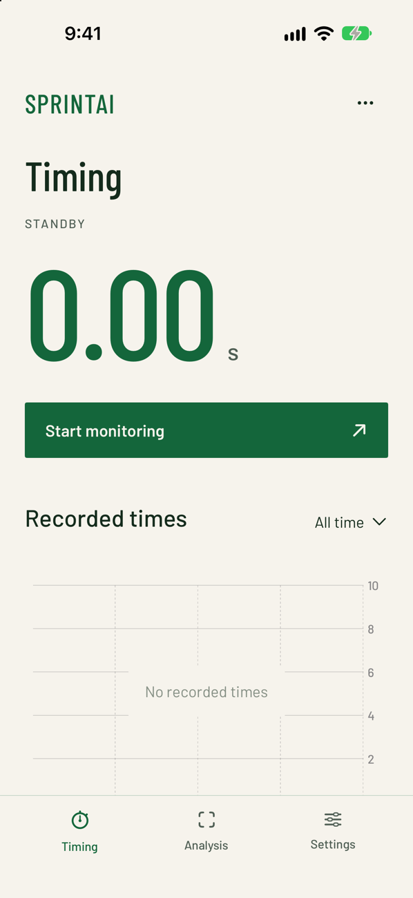
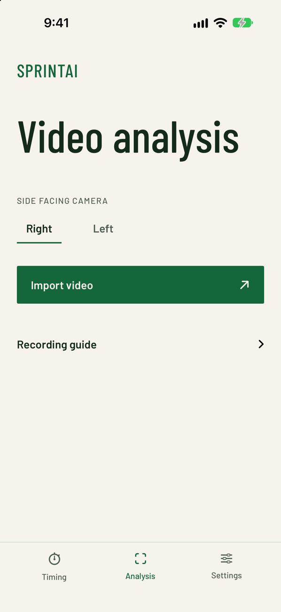
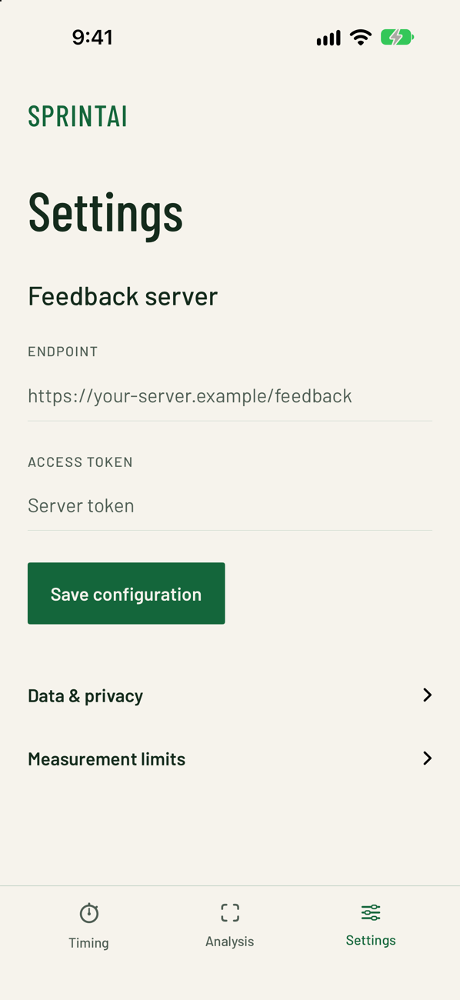
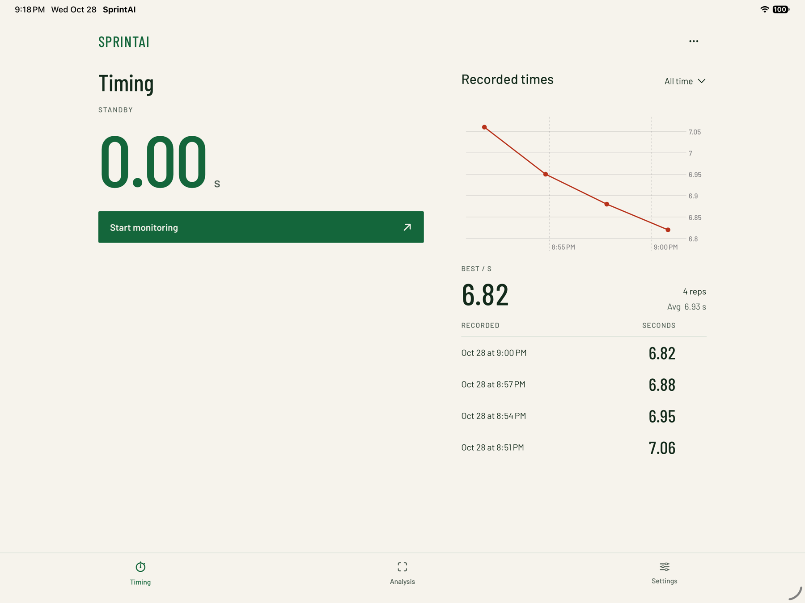

# SprintAI

**Automatic sprint timing and video form analysis for iOS.** Built by Matthew Tybur with SwiftUI, Core Motion, a TensorFlow-trained Core ML sprint detector, and MediaPipe pose estimation.

SprintAI brings two training tools into one app: detect sprinting from a phone's motion sensors, and inspect sprint mechanics from a side-view video. Optional AI coaching turns selected frames and measured angles into written observations.

> Development project. Motion timing has not been calibrated against race timing equipment. Pose angles are 2D estimates; the app does not claim laboratory-grade biomechanics or finish-line timing accuracy.

## Features

- **Automatic timing:** timestamp-resampled motion inputs at 50 Hz, sliding-window inference, and debounced sprint detection with confirmation-delay correction.
- **Session history:** local sprint records, fastest/average summaries, color-coded charts, all-time history, point selection, and confirmed deletion.
- **Race callouts:** “On your marks,” “Set,” and a randomized start signal.
- **Video analysis:** local pose detection, skeleton overlays, and camera-side hip, knee, and torso measurements that follow playback without bridging detection gaps.
- **Export:** save annotated videos to Photos or share the exported file. Exports contain video only, without the source audio.
- **Optional AI feedback:** send up to 14 compressed frames through your own authenticated backend. No OpenAI API key is bundled in the iOS app.

## Screenshots

| Timing | Analysis | Settings |
|---|---|---|
|  |  |  |

Screenshots show the green color scheme, Barlow typography, and open layout on the iPhone 18 Pro / iOS 27 simulator. The tablet preview uses four synthetic demonstration records; no athlete footage or real training records are included.



See the [design rationale and verification](Docs/DESIGN.md).

## Run the app

Requirements: macOS, **Xcode 15.4 or later**, iOS 17 or later, and **CocoaPods 1.16.2**. A physical iPhone is required to exercise motion timing; the simulator supports the screens and video analysis.

```sh
git clone https://github.com/tymatt1/SprintAI.git
cd SprintAI
pod install --deployment
open SprintAI.xcworkspace
```

If `xcodebuild` reports that only Command Line Tools are selected, choose Xcode in **Xcode → Settings → Locations**, or set `DEVELOPER_DIR` for your shell:

```sh
export DEVELOPER_DIR=/Applications/Xcode.app/Contents/Developer
```

Select the **SprintAI** scheme. For a physical device, select your own signing team. The bundle identifier remains `com.matthewt.SprintTimer` to preserve continuity with existing installations; change it if you need a separate development install.

Timing and local pose analysis work without server credentials. For video analysis, select one video up to 60 seconds long and 4096 pixels per side; short clips under 20 seconds filmed perpendicular to the athlete are recommended. Select the side facing the camera before import.

## Optional AI coaching

The iOS app calls a configurable `/feedback` endpoint rather than OpenAI directly. Configure your own server URL and access token in the app's **Settings** tab. The token is stored in Keychain.

A small authenticated **local development gateway**, with validation and bounded requests, is included in [Backend](Backend/README.md). It forwards requests to the OpenAI Responses API using a server-side environment variable. No hosted backend is provided by this repository. Production deployment still requires HTTPS, per-user authentication, and infrastructure-level abuse controls.

## Structure

```text
SprintAI/
  App/                     App entry point and tab navigation
  Core/                    Platform-independent timing, geometry, frame selection
  Features/
    Timing/                Motion inference, sprint state, records, charts, audio
    Analysis/              Video import, pose processing, annotation, playback, export
    Feedback/              Backend client, secure configuration, feedback UI
  Resources/               App assets, callouts, Core ML and MediaPipe models
  Shared/                  Reusable view components and extensions
Tests/
  SprintCoreTests/         Swift Package regression tests
  SprintAIIntegrationTests/ Hosted iOS inference and video tests
Backend/                   Optional development gateway and HTTP tests
Docs/                      Architecture, model notes, privacy, validation
```

The exported Core ML model is the custom sprint classifier. The bundled MediaPipe pose weights match Google's standard full-pose model; sprint-specific form analysis is implemented in Swift. See [model provenance and limitations](Docs/Models/README.md).

## Validation

```sh
# Pure timing/geometry/frame-selection tests; no simulator or credentials needed
swift test

# Gateway validation and HTTP tests; all provider calls are mocked
python3 -m unittest discover -s Backend -v

# App/model/video integration tests; choose an installed simulator
xcodebuild test -workspace SprintAI.xcworkspace -scheme SprintAI \
  -destination 'platform=iOS Simulator,name=iPhone 15' \
  CODE_SIGNING_ALLOWED=NO

# Check tracked files and publication branch history for common credential patterns
python3 Scripts/check_repository.py --history
```

GitHub Actions runs the core/backend checks and iOS integration tests. See [validation and remaining device checks](Docs/VALIDATION.md) for what these tests establish and what still needs real-world measurement.

## Development notes

- [Architecture and data flow](Docs/ARCHITECTURE.md)
- [Model provenance, preprocessing, and evaluation gaps](Docs/Models/README.md)
- [Privacy and data handling](Docs/PRIVACY.md)
- [Third-party notices](THIRD_PARTY_NOTICES.md)

Generated Pods, local Xcode state, credentials, raw training data, and legacy archives are excluded from Git. Model exports required to run the app are included.

## License

A license for the original SprintAI source and custom model has not yet been selected. Third-party components retain their own licenses; see [THIRD_PARTY_NOTICES.md](THIRD_PARTY_NOTICES.md).
